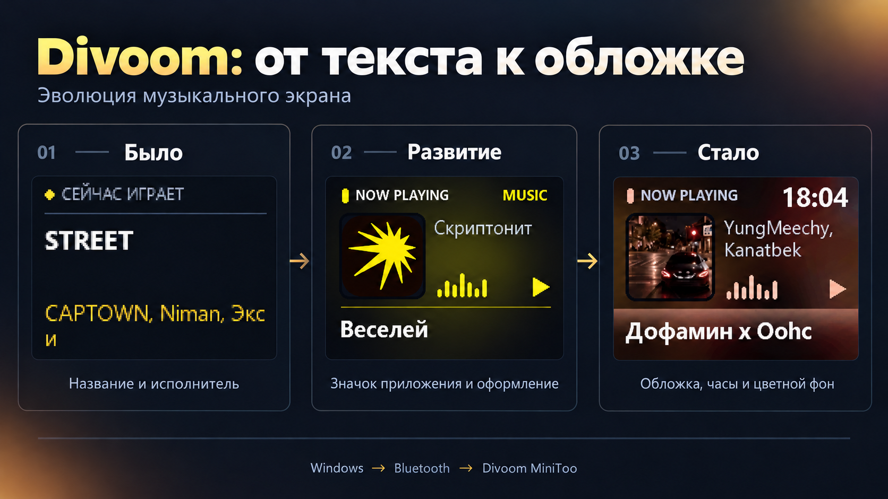

<div align="center">

# Divoom Music Display

**Музыка с компьютера — на экране Divoom.**

[](https://github.com/KulchePlus/divoom-music-display/releases/latest)


[](https://github.com/KulchePlus/divoom-music-display/actions/workflows/build.yml)

[Скачать приложение](https://github.com/KulchePlus/divoom-music-display/releases/latest) · [Сборка](#сборка-из-исходников) · [История изменений](CHANGELOG.md)



</div>

Divoom — настольное приложение, которое получает название песни, исполнителя и обложку
из системных медиасессий Windows и выводит карточку на **Divoom MiniToo**.
Музыкальные аккаунты, API-ключи и подписки для подключения не нужны.

> **Поддерживаемая модель:** MiniToo, экран 160×128. Название проекта — Divoom;
> совместимость с другими моделями пока не проверена.

## Возможности

- **Текущая музыка Windows.** Проверены Яндекс Музыка и Firefox; источник должен публиковать SMTC-метаданные.
- **Карточка с обложкой.** Фон в её цветах, исполнитель, название, часы и градиентный разделитель.
- **Значок проигрывателя** вместо обложки, если приложение её не предоставляет.
- **Длинные названия** перелистываются страницами по две строки, каждые 3 секунды.
- **Контроль размера:** лимит на кадр, 8 / 16 / 32 / 64 / 128 / 256 цветов, максимум 1–64 кадра.
- **Управление подключением:** список подключённых Bluetooth-устройств без фильтра по имени, статус, запоминание устройства и живой предпросмотр.
- **Тёмный интерфейс RU/EN** со скруглениями и подсказками при наведении.
- **Debug:** ручная генерация и отправка изображения заданного объёма для проверки LOADING.

## Быстрый старт

1. В [Releases](https://github.com/KulchePlus/divoom-music-display/releases/latest) скачайте ZIP для Windows x64.
2. Распакуйте его в папку, доступную для записи. Для готового EXE Python не нужен.
3. Сопрягите MiniToo с компьютером в настройках Bluetooth Windows.
4. Запустите `Divoom.exe`, выберите свой MiniToo в списке подключённых Bluetooth-устройств и нажмите **Подключиться**.
5. Включите музыку. Предпросмотр работает и при отключённом устройстве.

**USB используется для звука и питания. Для экрана нужен Bluetooth Classic RFCOMM.**
При активном соединении выбор устройства заблокирован. Кнопка **Отключиться** освобождает
соединение; закрытие приложения завершает работу. Последняя карточка может остаться на устройстве.

## Настройка передачи

| Параметр | Рекомендуем начать с | Что меняется |
|---|---|---|
| Лимит кадра | **24 КБ** | Верхняя граница размера каждого кадра; 1 КБ = 1024 байта |
| Количество цветов | **128** | Меньше цветов — меньше данных, но грубее цветовые переходы |
| Максимум кадров | **1–2** | 1 — первые две строки, 2 — первые четыре; оставшийся текст отсекается |

Нажмите **Применить** для сохранения. Значки ⓘ показывают пояснения при наведении.
Сохранённые настройки имеют приоритет над значениями по умолчанию (24 КБ, 256 цветов, 64 кадра).

Один кадр по возможности передаётся в RGB + Zstandard без потерь. Для нескольких кадров
используется JPEG-анимация с общей палитрой и подбором качества. Предпросмотр показывает
окончательное декодированное изображение. Если лимит недостижим, новая карточка не отправляется.

> Лимит относится **к одному кадру**, а анимация загружается целиком. Поэтому даже при
> небольших кадрах возможна надпись LOADING. Уменьшайте максимум кадров, чтобы сократить всю загрузку.

## Debug

Маленький значок жука в правом нижнем углу открывает отдельное окно:

1. Укажите размер в КБ и нажмите **Генерировать**.
2. Подключитесь к MiniToo в основном окне.
3. Нажмите **Отправить** и отметьте, появилась ли надпись LOADING.

Каждое нажатие отправляет ровно одно тестовое изображение. Пока Debug открыт, автоматические
обновления приостановлены; закрытие Debug возвращает обычную карточку. JPEG дополняется
служебными сегментами до заданного размера: тест измеряет влияние объёма, а не сложности декодирования.

## Требования

- Windows 10 / 11 x64; небольшое нативное скругление окон доступно на Windows 11.
- Bluetooth-адаптер с поддержкой Classic RFCOMM и сопряжённый MiniToo.
- Windows PowerShell 5.1, установленный в системе.
- Для исходников и сборки: **Python 3.12 x64 с Tcl/Tk**, Git и доступ к PyPI.

## Сборка из исходников

```powershell
git clone https://github.com/KulchePlus/divoom-music-display.git
cd divoom-music-display
powershell -ExecutionPolicy Bypass -File .\Build.ps1
```

Скрипт создаёт `.venv`, устанавливает версии из `requirements-build.txt`, проверяет версию
и собирает самостоятельный **`Divoom.exe` в корне проекта**. Пути к компьютеру автора не нужны.
Если Python установлен без команды `py`, укажите путь:

```powershell
.\Build.ps1 -Python 'C:\Python312\python.exe'
```

Повторная сборка без переустановки зависимостей: `.\Build.ps1 -SkipInstall`.
Закройте приложение перед пересборкой EXE.

Для запуска из исходников после подготовки окружения:

```powershell
.\.venv\Scripts\python.exe minitoo_app.py
```

### Проверки

```powershell
powershell -ExecutionPolicy Bypass -File .\scripts\test.ps1
```

Проверки охватывают лимиты, палитры, порядок страниц, ручные отправки, UI, выбор устройства и языки.
Они не подключаются к реальному устройству. Дополнительная локальная проверка `Divoom.exe --self-test`
читает текущую медиасессию Windows и проверяет упакованные ресурсы, но ничего не отправляет на MiniToo.

## Обновление приложения

Переключатель **Автообновления** включает или выключает проверку при запуске.
Выбор сохраняется в `update-preferences.json`; по умолчанию проверка включена.
Включение переключателя во время работы не запускает проверку — она произойдёт
при следующем открытии приложения. Периодических проверок нет.

При включённом переключателе приложение при запуске один раз проверяет последний стабильный релиз
`KulchePlus/divoom-music-display` через публичный GitHub API. Есть кнопка
**Проверить обновления** для повторной проверки. Черновики, предварительные
релизы и версии не новее установленной пропускаются. Ошибка сети не мешает музыке.

Если вышла новая версия, кнопка меняется на **Установить v… и перезапустить**.
Только её нажатие начинает загрузку ZIP и проверку по `SHA256SUMS.txt` того же релиза.
Из архива берётся только `Divoom.exe`; файлы настроек из ZIP не устанавливаются.

После проверки скрытый PowerShell-помощник ждёт закрытия приложения,
сохраняет прежний EXE в `Divoom.previous.exe`, заменяет приложение и запускает его снова.
При ошибке замены помощник возвращает прежний EXE. Логи установки — `update.log`.
После успешной замены запуска новой версии автоматический откат при её сбое пока не предусмотрен.
Для ручного отката закройте приложение и замените `Divoom.exe` резервной копией.

Настройки, выбранное устройство, логи и кэш остаются рядом с EXE.
Проверка SHA-256 защищает целостность загрузки; она не заменяет цифровую подпись издателя.
Для обновлений нужен доступ к GitHub и право записи в папку приложения.
При запуске из исходников можно проверять версии, но установка доступна только в EXE.
Сетевой запрос не включает название трека, исполнителя или Bluetooth-адрес.

Механизм обновлений доступен начиная с **v1.3.1**. Для перехода с v1.2.13
скачайте новую версию вручную; последующие обновления можно устанавливать из приложения.

## Версии и релизы

Версия в разработке: **1.3.2**. Последний стабильный релиз — **1.3.1**. Используется Semantic Versioning и теги `vMAJOR.MINOR.PATCH`.

При обновлении согласованно измените `version.py`, `version_info.txt`, `CHANGELOG.md`
и добавьте заметки в `docs/releases/vX.Y.Z.md`. Скрипт `scripts/check-version.py`
проверяет версию приложения, метаданные EXE и тег.

GitHub Actions проверяет и собирает проект на Windows. Публикация тега `v*` запускает выпуск
ZIP с приложением и SHA-256. Исходники нужной версии GitHub прикладывает к релизу автоматически.
Версия также видна в заголовке приложения и свойствах файла EXE.

## Структура проекта

| Файл | Назначение |
|---|---|
| `minitoo_app.py` | Главное окно и контроллер соединения |
| `now_playing.py` | Windows SMTC, рендер карточки и протокол MiniToo |
| `transmission.py` | Палитры, лимиты и подготовка кадров |
| `paired_devices.py` | Поиск подключённых Bluetooth Classic и LE устройств |
| `debug_image.py`, `debug_window.py` | Ручная диагностика передачи |
| `ui_*.py` | Оформление, переводы и подсказки |
| `Get-NowPlaying.ps1`, `Export-AppIcon.ps1`, `Get-ConnectedBluetooth.ps1` | Мост к Windows и значки приложений |
| `Divoom.spec`, `Build.ps1` | Упаковка EXE через PyInstaller |

## Локальные данные и ограничения

Настройки, выбранное устройство, логи и кэш значков сохраняются **рядом с EXE**:
`settings.json`, `ui-preferences.json`, `device-preferences.json`, `now-playing.log`,
`debug-results.jsonl`, `assets/app-icons/`. Они не включены в репозиторий и релиз.

- Обложка доступна только когда проигрыватель передаёт её Windows.
- Звук сам по себе не содержит метаданных: Firefox должен публиковать медиасессию.
- При нескольких источниках предпочтение отдаётся играющей текущей системной сессии.
- Часы сейчас показывают **московское время**.
- Новая загрузка нужна при смене трека, обложки, статуса или минуты; возможен LOADING.
- В список попадают устройства с активным Bluetooth-соединением в Windows, независимо от названия. Для обновления списка нажмите «Обновить». Совместимость отправки изображения пока проверена только с MiniToo.
- Приложение Divoom на телефоне не должно одновременно занимать соединение управления.
- Сборка не подписана цифровым сертификатом. Проект не является официальным приложением Divoom.

## Благодарности

Исследование протокола: [lewilou22/divoom-minitoo-tools](https://github.com/lewilou22/divoom-minitoo-tools).
Используются [Pillow](https://python-pillow.org/), [Zstandard](https://github.com/indygreg/python-zstandard)
и [PyInstaller](https://pyinstaller.org/). Подробности сторонних компонентов — в [THIRD_PARTY_NOTICES.md](THIRD_PARTY_NOTICES.md).
